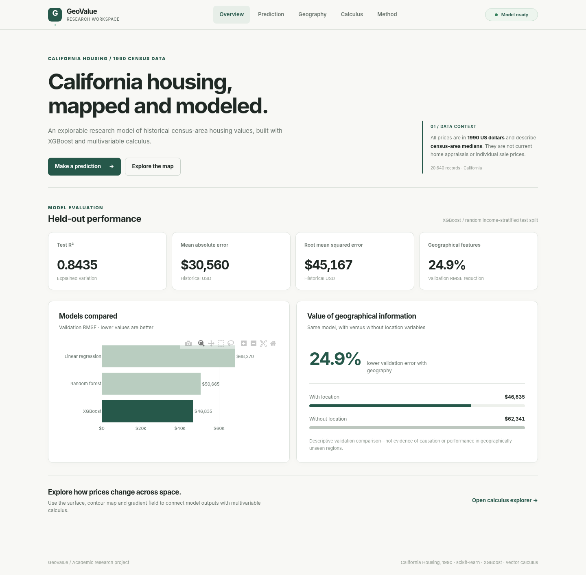

# GeoValue

**Historical housing-value prediction and geospatial calculus**  
Python 3.12+ · scikit-learn · XGBoost · NumPy/SciPy · FastAPI · pytest

GeoValue is a **local-first university research application** built around the California Housing Prices dataset (1990 census-area statistics). It combines supervised regression, geographical visualization, and a smoothed two-variable price surface for numerical gradient and double-integral analysis. The predictions are **historical area-level median values**, not prices of individual homes or current appraisals.



*Interface screenshot from a synthetic browser-test fixture. The model-evaluation figures in this repository are taken from the separately recorded real-data experiment; the plotted locations in the screenshot are not experimental evidence.*

## What works

- Validate the 20,640-record housing dataset and summarize its numerical/categorical fields.
- Engineer housing ratios and train Linear Regression, Random Forest, and XGBoost with an income-stratified 60/20/20 development/validation/test split.
- Select by validation RMSE, refit on the development partition, and evaluate once on a held-out test partition.
- Predict from single feature sets, CSV batches, or a local browser form.
- Create observed/predicted geographical displays, 3D scenario surfaces, contours, gradient fields, and numerical double-integral reports.
- Run synthetic-data unit and integration tests locally or in GitHub Actions.

## Recorded result

| Model selected | Held-out MAE | Held-out RMSE | Held-out R² |
|---|---:|---:|---:|
| XGBoost | $30,559.76 | $45,167.23 | 0.84347 |

Values are in **historical 1990 US dollars**. Source of record: [`public/data/training-report.json`](public/data/training-report.json). These results are based on a random income-stratified holdout, **not** a geographical holdout.

## Local setup

Use Python **3.12** for compatibility with the recorded model. From the repository root, create and activate an environment. On macOS, an internal-drive environment is recommended if the project is stored on an external SSD:

```bash
uv python install 3.12
uv venv --python 3.12 "$HOME/.venvs/geovalue"
source "$HOME/.venvs/geovalue/bin/activate"
uv pip install --link-mode copy -e ".[ml,geo,web,dev]"
```

For other platforms, use a Python 3.12 virtual environment and `python -m pip install -e ".[ml,geo,web,dev]"`.

Obtain `housing.csv` from [Kaggle's California Housing Prices dataset](https://www.kaggle.com/datasets/camnugent/california-housing-prices) and place it at `data/raw/housing.csv` if you intend to retrain. Never use a different dataset without first confirming its schema and provenance.

```bash
python -m pytest -q
python -m uvicorn app:app --reload
```

Open **http://127.0.0.1:8000**. Use `python -m uvicorn`, rather than a system-wide `uvicorn` executable, to select the active interpreter. Existing trusted model and dashboard assets can support the interface without retraining; to rebuild them from your own dataset, see the [User guide](docs/USER_GUIDE.md).

## CLI quickstart

```bash
geovalue inspect --data data/raw/housing.csv --output reports/dataset-summary.json
geovalue train --data data/raw/housing.csv --model-output artifacts/housing-model.joblib --report-output reports/training-report.json --seed 42
geovalue analyze --data data/raw/housing.csv --model artifacts/housing-model.joblib --output-dir reports/geospatial --grid-size 90 --sigma 1.6 --support-km 45
geovalue predict --model artifacts/housing-model.joblib --input data/examples/prediction-input.csv --output reports/predictions.csv
```

Local generated data, calculations and models should be backed up using `python scripts/package_full.py`. Do not replace a working project directory just to update documentation.

## Documentation

| Document | Contents |
|---|---|
| [Architecture](docs/ARCHITECTURE.md) | Modules, data flow, persistence and application boundaries |
| [Methodology](docs/METHODOLOGY.md) | Dataset, modeling, reproducibility, geographical calculus |
| [User guide](docs/USER_GUIDE.md) | Installation, commands, GUI, outputs and troubleshooting |
| [Testing](docs/TESTING.md) | CI, unit tests, stress evidence and limits |
| [Project report](docs/PROJECT_REPORT.md) | Academic report with results, equations, discussion and references |
| [Figures](docs/FIGURES.md) | Screenshot and results-figure catalog |
| [References](docs/REFERENCES.md) | Dataset, algorithms, scientific tools and projection sources |
| [Release notes](docs/RELEASE_NOTES.md) | What is completed, known limitations and provenance |

The historical implementation notes remain at [Task 2](docs/TASK_2.md), [Task 3](docs/TASK_3.md), and [Task 4](docs/TASK_4.md).

## Scope and limitations

GeoValue is an educational prototype, not a valuation service. The geographical-gradient explorer differentiates a **Gaussian-smoothed fixed-feature surface**, not raw XGBoost trees. Spatial gradients are descriptive, not causal, and the numerical integration region is a sample-supported grid, **not California's administrative land boundary**. Some browser charts require internet access to load Plotly JavaScript from a CDN; hosting is not required, but the browser is not fully offline. The Vercel deployment was deliberately abandoned, and cloud operation is not part of the final deliverable.

The raw dataset and locally generated artifacts are excluded from normal Git staging. Use only `.joblib` model files you created or independently trust; loading Joblib files can execute arbitrary code.
