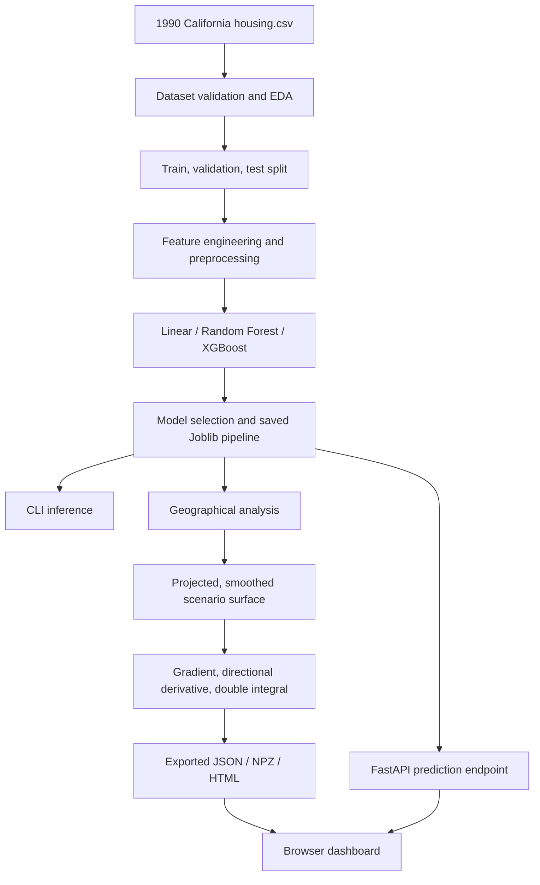

> **Legacy California baseline documentation.** This file describes the original 1990 census-area project. The primary GeoValue release now uses official Allegheny County transaction records through 2025; see [official project documentation](official/PROJECT_REPORT.md) and [current methodology](official/METHODOLOGY.md).

# Architecture

## 1. Design objective

GeoValue is a local, single-repository Python application. It separates dataset validation, statistical learning, spatial mathematics, inference and browser presentation while sharing one fitted prediction pipeline between CLI and web API. There is no database, cloud deployment, online model-training endpoint or background processing requirement.

## 2. System diagram



## 3. Python package responsibilities

| Module | Responsibility |
|---|---|
| `data.py` | CSV reading, schema/range validation, descriptive statistics |
| `features.py` | Row-wise housing ratios, no fitted statistics |
| `modeling.py` | Estimator construction, fitted preprocessing, metrics, Joblib serialization |
| `training.py` | Income-stratified splits, baseline comparison, geographic ablation, final refit |
| `inference.py` | Validate and predict single or batch inputs |
| `geospatial.py` | California Albers coordinate projection, observed/predicted Folium map |
| `calculus.py` | Fixed-feature grid, support masking, Gaussian smoothing, partial derivatives, integration |
| `visualization.py` | 3D surface, contours, vector field HTML exports |
| `analysis.py` | Orchestrates full spatial analysis and generates report |
| `cli.py` | User-facing `geovalue` commands |
| `web.py` | FastAPI routes for the local dashboard and inference |

`app.py` re-exports the FastAPI ASGI app. `public/` contains HTML, CSS, JavaScript and already prepared JSON for browser use. The web layer does **not** fit a model or recalculate the full surface per request.

## 4. Data and artifact flow

1. Input is validated before model fitting. The model consumes nine original predictors; `median_house_value` is never used as an input.
2. A fitted scikit-learn `Pipeline` contains the feature transformer, numerical/categorical preprocessing and selected regressor.
3. `artifacts/housing-model.joblib` is the trusted training output. In local web mode, `web.py` looks for `deploy/housing-model.joblib` first, falling back to `artifacts/housing-model.joblib`. These are currently duplicates retained for compatibility with the former packaging workflow.
4. `reports/training-report.json` and `reports/geospatial/geospatial-report.json` document observed metrics and analysis parameters. `reports/geospatial/price-surface.npz` stores numeric arrays with NumPy pickle loading disabled.
5. `scripts/prepare_deployment.py` (historical filename) exports a sampled set of map points and JSON surface/report copies into `public/data/` and `deploy/`. **It is useful locally even though deployment is cancelled**; it never retrains.

### File-layout summary

```text
src/geovalue/       Python implementation
public/             browser UI and sampled JSON data
artifacts/          local trained models (normally Git-ignored)
reports/            local training and geospatial outputs (normally Git-ignored)
data/raw/           original California housing CSV (normally Git-ignored)
data/examples/      small sample input files
scripts/            reproducibility, data recovery and backup helpers
tests/              pytest unit and integration checks
docs/               authoritative technical and academic documentation
deploy/             legacy prepared web copies (used as local fallback)
```

The GitHub repository currently includes explicitly staged generated model and sample data from the abandoned deployment attempt. Those files are **not required for training**, and publishing a Joblib artifact does not make loading arbitrary third-party Joblib files safe.

## 5. API and browser responsibilities

| Endpoint | Behavior |
|---|---|
| `GET /api/health` | Indicates which model and geography assets are present |
| `GET /api/report` | Returns recorded ML evaluation JSON |
| `GET /api/geo-report` | Returns geographical calculus report JSON |
| `GET /data/points.json`, `/data/surface.json` | Supplies sampled map points and precomputed surfaces |
| `POST /api/predict` | Validates input, loads trusted pipeline and predicts an area-level median |
| `POST /api/gradient` | Samples the nearest supported numerical gradient; no raw XGBoost differentiation |

The server returns appropriate status codes: invalid input (`422`), absent required outputs (`503`) or unknown assets (`404`). The frontend provides navigation, form validation, accessible labels and screen-size-dependent chart layouts. Plotly is currently loaded from a CDN; a local server does not imply complete network independence.

## 6. Architectural choices

- **No database:** the dataset is a static research input; file-backed artifacts are simpler and more reproducible for course evaluation.
- **No cloud:** training and web presentation run on one developer machine. The former `vercel.json` is not part of the release path.
- **Reproducible core:** deterministic split seed, saved pipeline and machine-readable reports preserve an evidence trail.
- **Separation of concerns:** model evaluation is independent of presentation; all browser plots are downstream of precomputed outputs.
- **Trust boundary:** never accept uploaded pickled models; don't expose the full raw dataset through the web API.

See [Methodology](METHODOLOGY.md) for scientific assumptions and [Testing](TESTING.md) for how the boundaries are validated.
