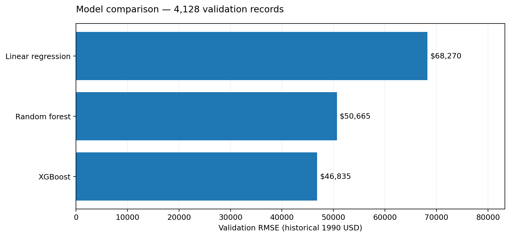
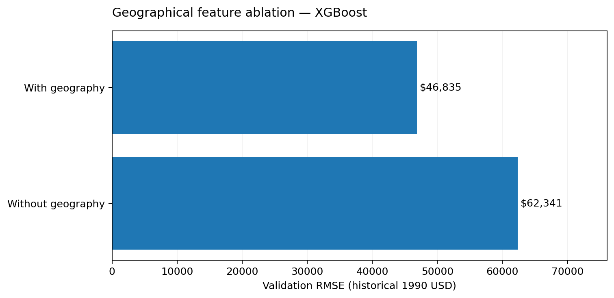

# Methodology

## 1. Research question and unit of analysis

Can historical California census-area median housing values be predicted from demographic, housing and geographic features, and can the learned spatial pattern be explored with mathematically well-defined numerical gradients and integrals?

The response variable, `median_house_value`, is a **census-area median expressed in 1990 US dollars**. It is not the value of an individual home, and this project does not forecast today's real estate market. The original Kaggle CSV has **20,640 rows**, nine input columns, one target, and **207 missing values in `total_bedrooms`**. The original values are capped at **$500,001** [1].

## 2. Predictors and engineered features

The original input fields are longitude, latitude, housing median age, total rooms, total bedrooms, population, households, median income and ocean proximity. Three ratios add interpretable density-related information:

$$
R_h = \frac{\mathrm{total\_rooms}}{\mathrm{households}},\quad
B_r = \frac{\mathrm{total\_bedrooms}}{\mathrm{total\_rooms}},\quad
P_h = \frac{\mathrm{population}}{\mathrm{households}}.
$$

Undefined ratios stay missing until the fitted preprocessing pipeline imputes them. Numeric features are median-imputed then standardized; `ocean_proximity` uses one-hot encoding with unknown-category handling. Feature construction itself learns no dataset-wide parameters.

## 3. Experimental design

The implementation uses seed **42** and an income-stratified random split when sufficient rows occur in each coarse income bin:

| Partition | Rows | Purpose |
|---|---:|---|
| Training | 12,384 | Fit candidate models and preprocessing |
| Validation | 4,128 | Select architecture by lowest RMSE and run geography experiment |
| Held-out test | 4,128 | Final measurement, after selection |

Linear Regression, Random Forest (**120 trees**) and XGBoost (**220 trees**) are compared on the same development splits. No fitted imputation or encoding statistics are calculated before the split. After selecting the lowest-validation-RMSE model, its architecture is refitted on **16,512** training-plus-validation records and evaluated **once** on the test partition [2, 3]. The implementation's tree settings are in `src/geovalue/modeling.py` and are not described as globally optimized hyperparameters.

### Model evaluation

For targets $y_i$, predictions $\hat y_i$, and $n$ observations:

$$
\mathrm{MAE}=\frac1n\sum_i|y_i-\hat y_i|,\qquad
\mathrm{RMSE}=\sqrt{\frac1n\sum_i(y_i-\hat y_i)^2},
$$

$$
R^2 = 1 - \frac{\sum_i(y_i-\hat y_i)^2}{\sum_i(y_i-\bar y)^2}.
$$

## 4. Actual model-selection results

All error values below are from the **real Kaggle-data run** recorded in `public/data/training-report.json`, not synthetic tests.

| Model | Validation MAE | Validation RMSE | Validation R² |
|---|---:|---:|---:|
| Linear Regression | $48,675.26 | $68,269.95 | 0.65396 |
| Random Forest | $32,751.25 | $50,664.57 | 0.80942 |
| **XGBoost** | **$30,766.08** | **$46,835.36** | **0.83714** |

The best validation architecture was **XGBoost**. After the final refit, the untouched test partition yielded **MAE $30,559.76, RMSE $45,167.23, and R² 0.84347**. Test results measure performance only under the random income-stratified holdout design.

## 5. Geography ablation

Using XGBoost with the same validation partition, the project compared all features against a version excluding latitude, longitude and ocean proximity:

| Condition | Validation RMSE | Validation R² |
|---|---:|---:|
| With geography | $46,835.36 | 0.83714 |
| Without geography | $62,340.61 | 0.71145 |

The RMSE difference was **$15,505.25**, a **24.87% reduction relative to the no-geography RMSE**. This is an association/feature ablation, **not** a causal impact estimate or proof of transfer to unseen geographical regions.

## 6. Construction of a smooth geographical scenario

The selected model predicts a multivariable function $f(x,y,z)$, where $(x,y)$ denotes location and $z$ contains housing-area attributes. To isolate position, non-geographical predictors—including the categorical ocean-proximity field—are held fixed at the sample median/mode. The project's controlled scenario therefore starts from

$$
P(x,y)=f(x,y,z_0).
$$

Longitude and latitude are projected to **EPSG:3310 (California Albers)** and converted from metres to kilometres [4]. A grid of **90 × 90** nodes is constructed; nodes more than **45 km** from any observed location are marked unsupported. A masked Gaussian filter with standard deviation **1.6 grid cells** smooths sampled predictions to produce $S(x,y)$ [5]. This is important: boosted trees are not a globally differentiable continuous surface, so **derivatives must not be presented as derivatives of the raw XGBoost predictor**.

Numerical partial derivatives are calculated using finite differences on the smoothed grid:

$$
\nabla S(x,y)=\left(\frac{\partial S}{\partial x},\frac{\partial S}{\partial y}\right),\qquad
\|\nabla S\|=\sqrt{S_x^2+S_y^2}.
$$

For a user-specified bearing $\theta$ clockwise from **projected grid north**, the directional derivative is

$$
D_\theta S=S_x\sin\theta+S_y\cos\theta.
$$

Gradient components and magnitudes use **historical USD/km**. The compass orientation is tied to the projected grid; the returned bearing should not automatically be treated as true-north navigation.

## 7. Numerical double integration

Only grid cells whose four corner values are finite contribute to the trapezoidal quadrature. Let $D$ be the supported-cell union, rather than an administrative map polygon:

$$
I=\iint_D S(x,y)\,dA,\qquad
\bar S_D = \frac{I}{\iint_D 1\,dA}.
$$

Actual recorded analysis values:

| Quantity | Value |
|---|---:|
| Finite/supported grid nodes | 4,226 of 8,100 |
| Fully supported quadrature cells | 4,027 |
| Integrated grid area | 475,526.91 km² |
| Integral | 77,293,915,044.23 historical USD·km² |
| Area-weighted mean of scenario surface | $162,543.73 |
| Mean spatial gradient magnitude | $351.86/km |
| Maximum sampled spatial gradient magnitude | $2,891.56/km |

The integrated area is a **computational grid region**, not California's land area; it may include non-land space and should never be used as an estimate of the state's geography. The surface mean is not the empirical mean of observed house values, and the gradient does not measure price appreciation or the causal effect of relocating housing.

## 8. Validity and reproducibility

- Historical and upper-coded targets restrict applicability; the $500,001 cap can distort errors near the top of the distribution.
- Income-stratified random splitting does **not** evaluate generalization to novel areas. A spatial-block holdout is appropriate for future work.
- The 3D calculus surface holds non-location variables constant; correlations and category-location relationships in actual neighborhoods may differ.
- Smoothing strength, support radius, grid size and projection influence the derived gradient and integral.
- Model-error metrics and UI screenshots come from **different evidentiary contexts**: real-data training reports versus synthetic browser fixtures.
- The saved model relies on compatible Python/scikit-learn/XGBoost/Joblib versions and must be loaded only from a trusted source.

For reproducibility, use `geovalue train --seed 42` and `geovalue analyze --grid-size 90 --sigma 1.6 --support-km 45` with the original dataset and recorded package versions. The exact input and training configuration are in the JSON report; screenshots alone do not establish statistical conclusions.

References [1–5] are in [REFERENCES.md](REFERENCES.md). See [TESTING.md](TESTING.md) for engineering verification.
