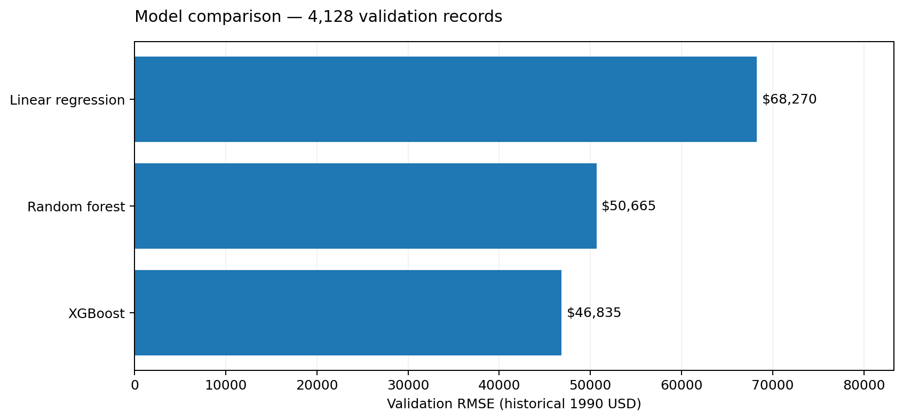
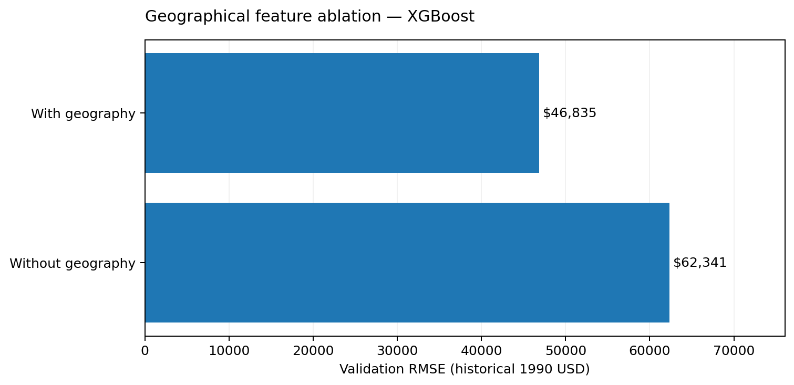

# GeoValue: Geospatial Housing Value Prediction and Multivariable Calculus Analysis

**Course:** Multivariable Calculus · **Institution:** Salim Habib University · **Academic term:** Fall 2026  
**Report type:** Final course-project report · **Implementation:** local Python CLI and FastAPI browser interface

## Abstract

This project studies historical California census-area median housing values using supervised regression and numerical multivariable calculus. A publicly available housing dataset containing 20,640 observations is validated, transformed and split into training, validation and held-out test sets. Linear Regression, Random Forest and XGBoost are compared by validation root mean squared error, with the selected model refitted and evaluated on the untouched test partition. XGBoost achieved a held-out RMSE of **$45,167.23** and an **R² of 0.84347**, expressed relative to historical 1990 house-value medians. A geographical feature ablation reduced validation RMSE by **24.87%** when latitude, longitude and ocean-proximity variables were included. To demonstrate applied multivariable calculus, the fitted model is evaluated across a projected spatial grid while non-location attributes remain fixed. The resulting scenario is smoothed, masked where observational support is insufficient, differentiated numerically, integrated over supported grid cells and explored using three-dimensional plots, contours and direction-dependent gradient queries. The output is a reproducible educational analysis and local application, not a current property-pricing tool.

**Keywords:** regression; XGBoost; California housing; geospatial analysis; multivariable calculus; partial derivatives; numerical integration.

## 1. Introduction

Housing-area values depend on multiple observed characteristics, including local geography, median income and the distribution of households and rooms. These relationships provide an accessible setting in which to connect multivariable functions to empirical data. Machine-learning models estimate the mapping from housing-area attributes to median value, while a controlled geographical scenario provides a two-dimensional mathematical surface for calculus operations.

The course outline emphasizes functions of several variables, partial derivatives, 3D surfaces, double integrals and vector fields [12]. GeoValue implements those concepts in a common codebase. It is deliberately scoped as a university proof of concept: no new regression algorithm is claimed, and no real-time market data or individual-sale information is included.

### Research objectives

1. Construct a validation-safe pipeline for historical census-area housing-value regression and compare interpretable and nonlinear baselines.
2. Quantify whether adding known geographical predictors improves validation accuracy under the study's random split.
3. Derive and visualize a mathematically interpretable, smoothed spatial price scenario with gradients and a double integral.
4. Deliver a locally runnable command-line interface, browser explorer and test evidence that can be reproduced without cloud deployment.

## 2. Dataset and problem definition

The study uses the *California Housing Prices* Kaggle dataset sourced from the 1990 census [1]. The target is `median_house_value`, an area median rather than an individual transaction amount. The dataset contains **20,640** observations, **nine input attributes**, and **207** missing `total_bedrooms` values. The original recorded median-house-value range extends to an upper-coded **$500,001** observation, which makes upper-range error interpretation sensitive to censoring.

The nine predictors are longitude, latitude, housing median age, total rooms, total bedrooms, population, households, median income and ocean proximity. The data-validation module checks required fields, numeric validity, positive household counts, legal coordinate ranges and accepted missing bedroom counts. Three ratios (rooms/household, bedrooms/room and population/household) provide scale-adjusted explanatory variables.

## 3. System design

The system separates data loading, feature engineering, model fitting, geospatial computation, numerical calculus, command-line inference and local browser presentation. A scikit-learn Pipeline guarantees that feature transformations, imputation, scaling and category encoding are fitted only on training rows during model selection [2]. The complete fitted pipeline is saved in Joblib format and consumed by the CLI and FastAPI prediction endpoint. Geographical calculations are performed in a batch analysis, not at request time; the browser reads precomputed surface and point JSON.

*Figure 1. Implemented GeoValue overview interface. Screenshot created using a synthetic browser-test fixture; not a plot of the project's actual housing observations.*

A module-level architecture description is included in [ARCHITECTURE.md](ARCHITECTURE.md).

## 4. Methods

### 4.1 Data partition and model evaluation

The validated records were split with seed 42 into **12,384 training**, **4,128 validation** and **4,128 test** rows. Broad median-income bins supported income-stratified random sampling. Linear Regression, a 120-tree Random Forest and a 220-tree XGBoost regressor were fitted to the training subset with shared preprocessing. The model family with the lowest validation RMSE was selected; it was refitted using the combined **16,512-row** development sample before a single held-out test evaluation [2, 3].

MAE evaluates average absolute difference, RMSE weights larger deviations more strongly, and R² compares predictions to a target-mean baseline:

$$
\mathrm{MAE}=\frac1n\sum_{i=1}^n|y_i-\hat y_i|,\quad
\mathrm{RMSE}=\sqrt{\frac1n\sum_{i=1}^n(y_i-\hat y_i)^2},\quad
R^2=1-\frac{\sum_i(y_i-\hat y_i)^2}{\sum_i(y_i-\bar y)^2}.
$$

### 4.2 Geographical experiment

A second version of the selected architecture excluded latitude, longitude and ocean proximity while preserving the training and validation subsets. This tests the predictive contribution of location-related information in the fitted model; it does not estimate causal geographic effects.

### 4.3 Mathematical surface

The trained regression function can be written $P=f(x,y,z)$, where $(x,y)$ are location variables and $z$ includes the other housing-area attributes. Non-geographical features were fixed at observed medians/mode, generating a two-variable scenario. Coordinates were projected to **EPSG:3310 (California Albers)** [4] and laid out on a **90 × 90** grid. Grid points farther than **45 km** from the nearest observed location were masked, then supported predictions were smoothed by a masked Gaussian filter with **$\sigma=1.6$ grid cells** [5]. The resulting $S(x,y)$ is a numerical scenario surface rather than a raw tree-derivative field.

The spatial gradient is

$$
\nabla S=(S_x,S_y),\qquad \|\nabla S\|=\sqrt{S_x^2+S_y^2},
$$

with a directional derivative for a bearing $\theta$ clockwise from projected grid north:

$$
D_\theta S=S_x\sin\theta+S_y\cos\theta.
$$

For supported grid cells forming $D$, the average modeled scenario value is

$$
\bar S_D=\frac{\iint_D S(x,y)\,dA}{\iint_D dA}.
$$

The quadrature uses four-corner cell averages with distance coordinates in kilometres. Units are historical USD/km for gradients and historical USD·km² for the integral. The supported region is not an official California land-boundary polygon.

## 5. Results

### 5.1 Model selection

| Candidate | Validation MAE | Validation RMSE | Validation R² |
|---|---:|---:|---:|
| Linear Regression | $48,675.26 | $68,269.95 | 0.65396 |
| Random Forest | $32,751.25 | $50,664.57 | 0.80942 |
| **XGBoost** | **$30,766.08** | **$46,835.36** | **0.83714** |

*Figure 2. Validation RMSE from the actual housing-data run. Lower is better; historical 1990 USD.*

XGBoost had the lowest validation RMSE among the three specified implementations. Its final refitted version recorded **held-out MAE $30,559.76**, **RMSE $45,167.23** and **R² 0.84347**. These figures come from the actual `public/data/training-report.json` and do not represent accuracy for present-day properties or an entirely new region.

### 5.2 Geographical-feature comparison

With geography, XGBoost validation RMSE was **$46,835.36**; removing geography increased it to **$62,340.61**. The difference of **$15,505.25** corresponds to a **24.87% reduction** relative to the version without location inputs. Validation R² increased from 0.71145 to 0.83714. The result indicates that location-linked features are useful within this experimental split; it does not prove location causes value differences.

*Figure 3. Actual validation RMSE with and without longitude, latitude and ocean proximity.*

### 5.3 Spatial calculus outputs

Using the real-data model, the analysis supported **4,226 of 8,100 grid points** and **4,027 fully supported integration cells**. The computational area summed to **475,526.91 km²**, the numerical integral to **77,293,915,044.23 historical USD·km²**, and the resulting area-weighted scenario mean to **$162,543.73**. Mean and maximum computed gradient magnitudes were approximately **$351.86/km** and **$2,891.56/km**, respectively. These are numbers from the actual run's `public/data/geospatial-report.json`, **not** a direct measurement of California's real geographic area or empirically observed property appreciation.

The spatial interface provides direction-dependent exploration and 3D or fallback-2D visualizations. The browser stress-audit geography screenshot uses synthetic fixture data and is therefore excluded from the numerical evidence above; it appears in the [figure catalog](FIGURES.md) as a UI implementation illustration.

## 6. Engineering verification

Automated tests cover schema validation, feature ratios, modeling, reproducible splitting, prediction, projection, numerical gradient/integration and API responses. The reviewed GitHub Actions run on commit `5a855bf` passed **67 tests**. A separate code-matched local audit measured approximately **90% line coverage** and exercised 500 inference requests (400 valid and 100 deliberately invalid), 60 supported gradient queries, and desktop/mobile browser flows. Those additional stress checks used a **synthetic test fixture**, not the research dataset; their response times are neither portable performance benchmarks nor model-accuracy results. Details are documented in [TESTING.md](TESTING.md).

## 7. Discussion and limitations

The comparison suggests that nonlinear regression is appropriate for this historical dataset and that geographic attributes carry predictive information, at least under the study's random income-stratified split. The mathematical surface then provides an intelligible way to apply partial derivatives, directional derivatives, vector visualization and double integration to the fitted model. The resulting explorer is an **integration of established methods**, not a novel estimator or a new calculus theorem.

Four limitations are especially important. First, the targets are censored historical census-area medians; applications to present-day properties would require recent transaction data and recalibration. Second, a random test partition may share neighborhoods with the training sample; no spatial-block cross-validation has been conducted. Third, fixed-feature smoothing changes the original XGBoost function, so gradient magnitudes depend on smoothing, grid resolution and support masking. Fourth, the integration domain is a numerical data-support region and may include space outside California's land boundary. It must not be interpreted as a physical area or a population-weighted average.

In the local browser, chart JavaScript is loaded from a CDN; the application is local-first but not fully air-gapped. The former Vercel deployment path was cancelled because keeping the project maintainable locally better matched its academic purpose.

## 8. Conclusion

GeoValue meets its scoped objectives: a tested local Python application predicts historical area medians with a selected XGBoost pipeline, compares geography-dependent performance, and converts a trained multivariable mapping into an explainable two-variable scenario for numerical differentiation and integration. Its strongest contribution for the course is the transparent bridge between model outputs and applied vector/multivariable calculus, coupled with explicit limits on what the resulting field means. The recorded accuracy and numerical integrals are reproducible from the original dataset and logged parameters, and the public source repository provides a verifiable implementation and test history.

## 9. Future work (not part of the delivered system)

The next defensible extensions would be geographically blocked evaluation, uncertainty quantification, a sensitivity experiment over surface smoothing parameters, a land-polygon-restricted integration domain, current-data benchmarking, and bundling Plotly locally for fully offline use. These are proposals, not claims of functionality already delivered.

## References

Citation numbers refer to [REFERENCES.md](REFERENCES.md), including the Kaggle dataset, scikit-learn, XGBoost, California Albers, SciPy/NumPy, FastAPI and the university course outline. Internal experiment evidence is preserved in `public/data/training-report.json`, `public/data/geospatial-report.json` and the documented GitHub Actions run.
