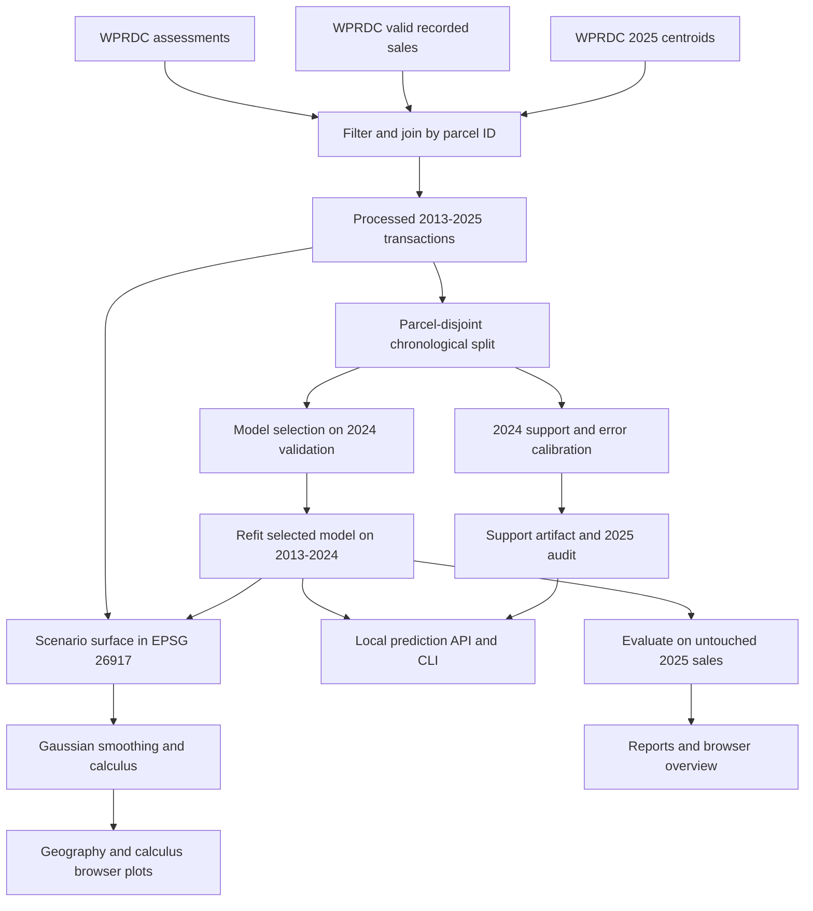

# GeoValue official-data system architecture

## Scope

GeoValue has two paths: the **official Allegheny County residential-sale system** (`geovalue-official` CLI, `/` browser, `/api/official/*` API) and the preserved **California historical census-area baseline** (`geovalue` CLI, `/legacy` browser and legacy API endpoints). The two targets, feature schemas and calculus coordinate systems are distinct and must not be mixed.

## Module boundaries

| Module | Responsibility |
|---|---|
| `geovalue.official.sources` | CKAN metadata, streamed official CSV downloads, hashes and provenance manifest |
| `geovalue.official.data` | Parcel-key normalization, explicit valid-sale filtering, assessment/centroid joins, processed dataset |
| `geovalue.official.modeling` | Property features, sklearn preprocessing, Linear/RF/XGBoost and Joblib persistence |
| `geovalue.official.training` | Chronological parcel-disjoint splits, architecture selection, geography ablation, municipality holdout |
| `geovalue.official.spatial` | UTM 17N coordinate conversion, fixed-feature price surface, gradient query |
| `geovalue.official.reliability` | Train-location k-nearest support, 2024 error calibration, 2025 holdout audit |
| `geovalue.official.analysis` | Full post-training analysis, map-point sampling, numerical surface, CSV conflict diagnosis, JSON exports |
| `geovalue.official.cli` | Source, build, profile, train, predict, analyze, audit and diagnostic commands |
| `geovalue.official.web` | Validated property, gradient, report and evidence API endpoints |
| `geovalue.web` | Local FastAPI host, static allowlist and original California endpoint compatibility |
| `public/official/` | Minimal local HTML/CSS/JS GUI and a bundled Plotly runtime |

## Core data flow



## Artifact structure

```text
artifacts/official/
  residential-sale-model.joblib        # trusted fitted model
  reliability-support.npz             # training+validation projected reference locations + cutoffs
reports/official/
  build-report.json                   # eligibility and source joins
  training-report.json                # 2024/2025 evaluation and ablations
  geospatial-report.json              # numerical scenario summary
  reliability-report.json             # support calibration and 2025 audit
  transaction-audit.json              # conflicting sale groups
  linear-diagnostics.json             # optional 2024 linear-baseline outlier report
  price-surface.npz                   # raw numerical grid and partial derivatives
public/official/data/
  points.json                         # sampled actual held-out 2025 transactions
  surface.json                        # web-ready numerical scenario
  training-report.json                # display copy
  geospatial-report.json              # display copy
  reliability-report.json             # display copy
```

The model is never trained by an HTTP request. Real-data reports are generated from local commands. Generated outputs are excluded from regular Git staging. **Only source files, tests, documentation, and the bundled static chart library are committed.**

## API boundaries

- `GET /` — official browser UI; `GET /legacy` — original California view.
- `GET /api/official/health` — local model, surface and reliability readiness.
- `GET /api/official/report`, `/geo-report`, `/reliability-report` — stored empirical reports.
- `POST /api/official/predict` — one property feature record; optional empirical spatial-evidence summary.
- `POST /api/official/gradient` — nearest finite official projected derivative sample.
- `GET /official/data/{filename}` — strict allowlist for browser JSON files.

FastAPI/Pydantic validate required ranges and return HTTP 422 for invalid input; missing trusted models or artifacts return 503. The web app **does not** accept user-submitted serialized models. All files are local; no database, web scraper or Vercel deployment is required.

## Important operational choices

- **Model persistence:** trusted Joblib pipeline includes preprocessing; never load untrusted `.joblib` files.
- **Coordinate reliability:** EPSG:26917 is measured in metres; all calculus distances are converted into kilometres. The old California EPSG:3310 projection remains confined to the legacy code.
- **UI compatibility:** regular Scatter plot for 2025 points avoids a mandatory WebGL context. If a 3D surface cannot render, the browser displays a contour fallback.
- **Offline charts:** Plotly JavaScript is vendored locally under `public/official/plotly.min.js`; no network CDN is required for the official UI. Its MIT license notice is in `public/official/plotly-LICENSE.txt`.
- **Reproducibility:** a source manifest preserves file hashes, retrieval dates and resource identifiers, while reports preserve empirical counts, software versions, splits and modelling configurations.

Read [METHODOLOGY.md](METHODOLOGY.md) for mathematical meanings and [USER_GUIDE.md](USER_GUIDE.md) for commands.
