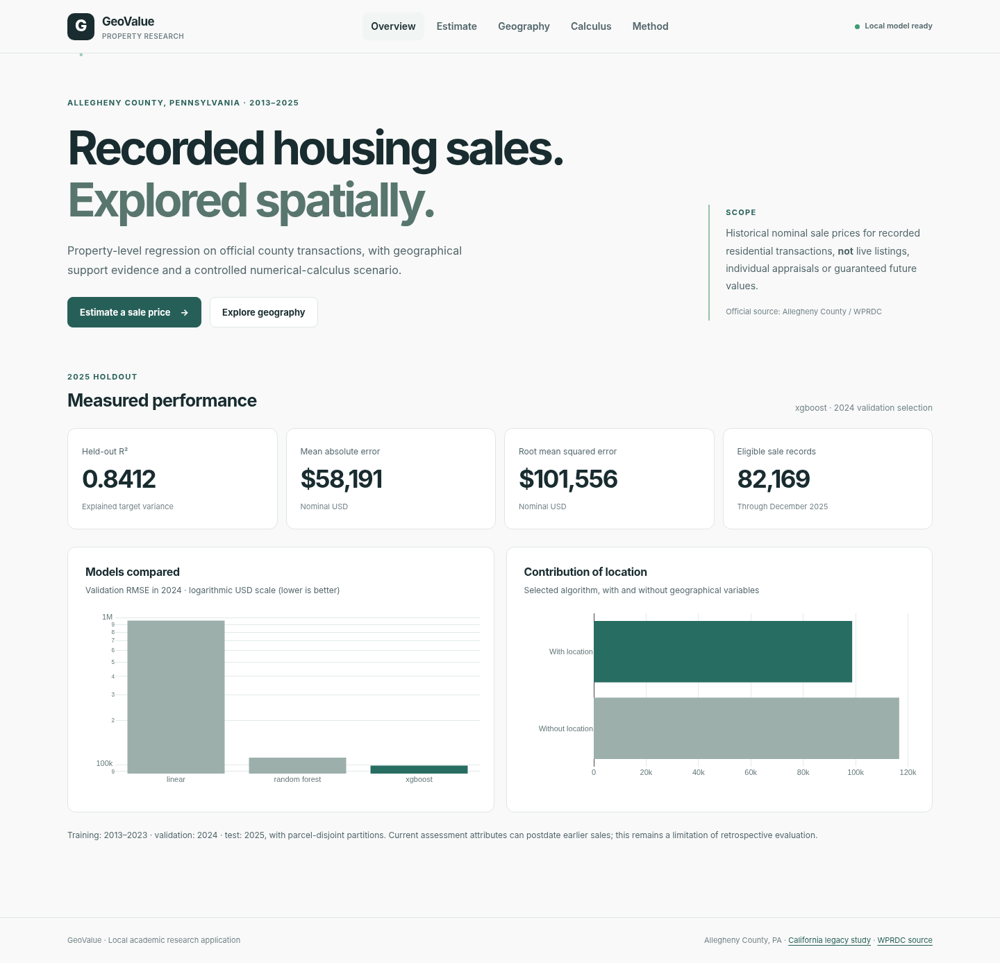

# GeoValue: Geospatial Residential Sale-Price Prediction and Spatial Evidence Using Machine Learning and Multivariable Calculus

**Final extension report · University MVC project · Local Python implementation**

## Abstract

GeoValue analyzes recorded residential property sales in Allegheny County, Pennsylvania using official county property assessments, sale transactions and parcel-centroid records. A reproducible source filtering and parcel-join procedure yielded **82,169 eligible sale transactions**, representing **72,607 unique parcels** from **2013 through 2025**. A supervised regression pipeline uses property structure, transaction date and geography to compare Linear Regression, Random Forest and XGBoost. The evaluation maintains parcel separation across chronological splits, selecting the model on 2024 validation RMSE and evaluating it on an untouched 2025 test cohort. XGBoost achieved 2025 **MAE $58,190.78**, **RMSE $101,555.74**, and **R² 0.84120**. Geographic information reduced validation RMSE by **$17,956.78** relative to a model excluding location features.

The project's incremental contribution is a **Spatial Evidence Indicator**: nearest-training-location support strata, calibrated against actual 2024 validation errors and audited separately using 2025 residuals. The application also constructs a controlled, Gaussian-smoothed geographical scenario in a kilometre-based coordinate system for numerical partial derivatives, directional derivatives, contour curves and double integration. Its gradient and integral results describe this mathematical scenario, not causal property value change. The implemented CLI, locally served GUI and automated tests support reproducible research; the system is not an appraisal or a real-time market forecasting platform.

**Keywords:** official property data; XGBoost; geospatial regression; support density; validation error; numerical gradient; multivariable calculus; area integration.

## 1. Research motivation and questions

Most regression dashboards display a point estimate without explaining how densely the proposed location is represented among development observations. GeoValue connects three course-relevant tasks: property-level supervised regression, explicit geographical generalization evaluation and mathematical analysis of a controlled spatial scenario. Its research questions are (1) which of three specified regression architectures best predicts eligible 2025 recorded sales, (2) how much location-related information contributes to holdout accuracy, and (3) whether a local-support statistic is associated with observed validation errors while enabling interpretable spatial gradients and integration.

## 2. Official data sources and filtering

Data come from the [Western Pennsylvania Regional Data Center](https://data.wprdc.org/): Allegheny County property assessments, recorded real-estate sales and March 2025 parcel centroids. County sources may be revised; a SHA-256 manifest records the actual download timestamp and resource identifiers. Parcel IDs are string-normalized before joining; leading zeroes are preserved.

Among **508,013 raw sale records**, the program excluded **407,162** entries without an explicit county-valid sale description and **9,972** by date/price filters. Valid residential property and centroid joins followed by physical-data screening yielded **82,169** transactions. The processed file has 19 base predictors, parcel/date metadata and the target `sale_price`. Property attributes include bedrooms, baths, finished floor area, lot area, age, condition and construction grade; location includes latitude, longitude, municipality and ZIP. The target is recorded **nominal-dollar** sale price.

**Data challenge:** the assessment snapshot may reflect changes occurring after older sale transactions. This temporal information limitation remains even when the model is evaluated chronologically; do not describe the model as a prospective point-in-time forecast. The program also flags **eight** conflicting same-parcel/same-date price groups without asserting which recorded amount is authoritative.

## 3. Model construction and validation

A scikit-learn Pipeline creates `property_age_at_sale`, `bathroom_equivalents` and `floor_area_ratio`, fits numerical median imputation/scaling and categorical most-frequent imputation/one-hot encoding, and applies a regression estimator. The split is parcel-disjoint: 2013–2023 training (**60,767**), 2024 validation (**8,656**) and 2025 test (**8,691**). The selected model is refitted on **69,423** development observations, then evaluated once on the test cohort.

| Algorithm | 2024 validation RMSE (USD) | R² |
|---|---:|---:|
| Linear Regression | $956,526.74 | -14.1316 |
| Random Forest | $111,735.19 | 0.7935 |
| **XGBoost** | **$98,697.19** | **0.8389** |

Extreme Linear Regression extrapolation dominated its 2024 RMSE. A diagnostic on the uploaded processed data found a very small recorded lot size and correspondingly large unbounded floor-area ratio. This is evidence of baseline instability, not a reason to delete legitimate county records without a documented rule.

**XGBoost test results:** MAE $58,190.78; RMSE $101,555.74; R² 0.84120. An ablation excluding four geography variables increased 2024 validation RMSE from $98,697.19 to $116,653.97 (approximately **15.39%** lower RMSE with geography). A separate pre-2024 municipality holdout achieved R² 0.76503 on 14,259 records. These experiments are descriptive associations, not causal results and not future-2026 performance forecasts.

## 4. Spatial evidence: the incremental novelty

The new indicator addresses the interpretability gap between a single prediction and the availability of geographically nearby training data. All locations are projected to EPSG:26917, converted to kilometres, and indexed with `cKDTree`. Each 2024 validation location is assigned a distance to its 10th-nearest *pre-2024 training location*. The first and second terciles of this distance define **dense, typical and sparse** support categories.

Within each validation category, the program computes the actual 2024 MAE, RMSE, median distance and 80th percentile absolute error of a model trained before 2024. The same previously fixed distance thresholds are then evaluated on the 2025 held-out cohort to check whether the observed error relationship transfers to future recorded sales. Neither test errors nor their locations set the thresholds. A user prediction displays the distance, its category, the 2024 group MAE and its historical error percentile. These are **not** confidence intervals; they characterize representation and validation outcomes, not individual guarantees.

The genuine novelty is **the measured, reproducible connection** between local spatial support and historical model error in the same application that provides model-based geographical calculus. It is an incremental methodological integration of established approaches, not a new estimator.

The author's post-upgrade report must be generated with `geovalue-official analyze` on the saved trusted model before quoting the precise distance cutoffs and groupwise errors. The original submitted Task 6 training report alone does not contain those Task 7 numbers.

## 5. Applied multivariable calculus

Write the fitted model as \(f(x,y,\mathbf z)\), where \((x,y)\) are geographical coordinates and \(\mathbf z\) are non-location characteristics. Fix \(\mathbf z=\mathbf z_0\), set the scenario transaction year to **2025**, and define \(P(x,y)=f(x,y,\mathbf z_0)\). The implementation transforms positions from longitude/latitude into NAD83 / UTM zone 17N (EPSG:26917), in kilometres, and samples an **86×86** geographical grid.

Since the XGBoost ensemble is piecewise constant, direct geographical derivatives are not informative. A Gaussian-smoothed, support-masked scenario \(S(x,y)\) is formed. Only nodes within **4.5 km** of an observed property location are retained. Numerical central differences compute:

\[
\nabla S=(S_x,S_y),\qquad \|\nabla S\|=\sqrt{S_x^2+S_y^2},\qquad D_\theta S=S_x\sin\theta+S_y\cos\theta.
\]

Bearing \(\theta\) is clockwise from **projected grid north**. Gradient units are nominal USD/km. The double integral accumulates the smoothed surface across fully supported grid cells:

\[
I=\iint_D S(x,y)\,dA, \quad \bar S_D=\frac{I}{\iint_D dA}.
\]

The implementation uses four-corner cell quadrature, producing a nominal USD·km² integral and an area-weighted scenario mean in USD. The computational domain is **not** the official Allegheny County administrative land boundary, and its integral is **not** the total market value of properties.

## 6. System implementation and verification

The code separates official source downloads, data joins, feature/model pipelines, chronology, geography, spatial-support calibration, and API presentation. The `geovalue-official` CLI can download/build/train/analyze independently of the GUI. FastAPI serves the new primary dashboard locally at `/`; the California original remains at `/legacy`. Plotly is bundled locally, with 2D fallbacks for WebGL-limited systems.

The Task 7 code-matched local test suite passed **123** tests, including numerical reference checks for projection and gradients, 2024 support calibration, end-to-end analytical outputs and API error behavior. The real uploaded processed dataset was also run through a separate local-model reconstruction; screenshot figures reflect that test harness and must not be mistaken for exact numerical results from the author's saved model.

*Figure 1. Browser functionality preview using the processed official data and an audit-environment refit. The performance summary displayed comes from the user's original full training report; visualizations are UI evidence only.*

## 7. Limitations and future work

1. Historical assessment snapshot leakage and potentially missing point-in-time features.
2. Explicit valid-sale filtering selects a subset of all property transactions.
3. No inflation adjustment across 2013–2025.
4. Extreme rare property ratios and unregularized linear model instability.
5. The spatial-support indicator may not be monotonic in observed errors; it is not an uncertainty guarantee.
6. The geographical surface fixes municipality/ZIP categories while varying position, and therefore may contain unrealistic feature-location combinations.
7. Numerical integration domain is a support mask, not an official county polygon.
8. The system has no model-based uncertainty interval, external appraisal validation or prospective 2026+ sale study.

Future extensions could use historical assessment snapshots, heteroskedastic conformal calibration with validated coverage, spatial-block holdout, official county polygon quadrature, and robust regression with carefully evaluated floor-area-ratio handling. These are **not** claims about the delivered functionality.

## 8. Conclusion

GeoValue now meets the instructor's two expanded requirements: it uses a documented, official large property-sale dataset with actual house and location characteristics, and it introduces an incremental, testable spatial evidence contribution. The full XGBoost model obtained a held-out 2025 R² of **0.84120**; the novelty and calculus are integrated into a local browser and CLI without claiming market causality or guaranteed prediction confidence. Final surface and support-audit numerical values must be cited from the local Task 7 outputs generated using the original saved model.

## References and source-of-record files

- [WPRDC Property Assessments](https://data.wprdc.org/dataset/property-assessments)
- [WPRDC Real Estate Sales](https://data.wprdc.org/dataset/real-estate-sales)
- [WPRDC Parcel Centroids, March 2025](https://data.wprdc.org/dataset/parcel-centroids-in-allegheny-county-with-geographic-identifiers)
- [EPSG:26917](https://epsg.io/26917)
- Official training evidence: `reports/official/training-report.json` (from user's uploaded full-data run)
- Data audit: `reports/official/build-report.json`; local source manifest in `data/official/raw/source-manifest.json`
- New Task 7 evidence: `reports/official/reliability-report.json`, `reports/official/geospatial-report.json`, `reports/official/transaction-audit.json`
- Mathematical and testing specifications: [METHODOLOGY.md](METHODOLOGY.md), [TESTING.md](TESTING.md)
